# 💼 KawanKerja AI: Asisten Regulasi Ketenagakerjaan Indonesia (PP No. 35 Tahun 2021)

[](https://python.org)
[](https://groq.com)
[](https://fastapi.tiangolo.com)
[](https://streamlit.io)
[](https://langchain.com)
[](https://smith.langchain.com)
[](https://docker.com)
[](.github/workflows/ci-cd.yml)

> **KawanKerja AI** adalah sistem Retrieval-Augmented Generation (RAG) cerdas yang dirancang untuk menjawab konsultasi hak dan kewajiban kerja karyawan dan HR di Indonesia berdasarkan rujukan hukum resmi **Peraturan Pemerintah (PP) No. 35 Tahun 2021** (PKWT, Alih Daya, Waktu Kerja & Lembur, serta Pemutusan Hubungan Kerja).

Sistem ini ditenagai oleh model open-weights mutakhir **Qwen 3.8 27B** dengan akselerasi inferensi ultra-cepat menggunakan **Groq LPU**, arsitektur **Hybrid Retrieval (BM25 + ChromaDB)**, **Cross-Encoder Reranker**, dan pelacakan observabilitas end-to-end via **LangSmith**.

---

## 🎯 Latar Belakang & Nilai Bisnis

Regulasi ketenagakerjaan di Indonesia (khususnya turunan UU Cipta Kerja pada PP No. 35 Tahun 2021) memiliki klausul hukum yang rumit dengan keterkaitan antar-pasal (*cross-referencing*), rumus perhitungan uang kompensasi PKWT yang rigid, serta ketentuan pesangon PHK yang memiliki banyak skenario alasan pemutusan.

**Kelemahan Naive RAG:**
1. *Semantic-only search* sering meleset saat mencari nomor pasal spesifik (misal: mencari *"Pasal 26 ayat (1)"*).
2. Jawaban sering berhalusinasi atau memberikan angka perhitungan pesangon tanpa dasar hukum yang jelas.
3. User tidak dapat memverifikasi sumber asli regulasi.

**Keunggulan KawanKerja AI:**
Mengintegrasikan **Hybrid Search (BM25 + Dense Vector Search)** dengan **Cross-Encoder Reranker** untuk menjamin akurasi rujukan pasal, dilengkapi guardrails anti-halusinasi dan ekstraksi sitasi halaman dokumen secara transparan.

---

## 🏗️ Arsitektur Sistem

```mermaid
flowchart TD
    subgraph INGESTION["1. Pipeline Ingestion Dokumen"]
        PDF["Dokumen Resmi: PP No. 35/2021"] --> Loader["PyPDFLoader (Ekstraksi Halaman & Metadata)"]
        Loader --> Splitter["RecursiveCharacterTextSplitter (chunk: 1000, overlap: 150)"]
        Splitter --> Embed["Gemini Embedding 1 (Google AI Studio)"]
        Embed --> Chroma[("ChromaDB Vector Store")]
    end

    subgraph QUERY["2. Pipeline Advanced Retrieval & Generation"]
        UserQuery(["Pertanyaan Pengguna"]) --> MultiQ["MultiQueryRetriever (Query Expansion)"]
        MultiQ --> BM25["Sparse Retriever (BM25)"]
        MultiQ --> Dense["Dense Retriever (ChromaDB)"]
        BM25 & Dense --> Ensemble["EnsembleRetriever (Hybrid Search 50:50)"]
        Ensemble --> Rerank["Neural Reranker (NVIDIA Nemotron 3.5 Rerank 8B via OpenRouter)"]
        Rerank --> Context["Top-K Konteks Grounded + Sitasi Halaman"]
        Context --> PromptTemplate["Prompt Guardrail Hukum"]
        PromptTemplate --> LLM["Groq LPU: Qwen 3.8 27B"]
        LLM --> FinalAnswer(["Jawaban Terstruktur + Referensi Pasal & Halaman"])
    end
```



---

## 🚀 Fitur & Keunggulan Teknis

1. **Inference Ultra-Cepat dengan Groq LPU**:
   - Memanfaatkan model **Qwen 3.8 27B** yang di-host di infrastruktur Groq LPU untuk responsivitas instan tanpa jeda antrean.
2. **Hybrid Retrieval (Sparse + Dense)**:
   - **BM25 Retriever** menangkap kata kunci istilah hukum yang presisi (contoh: *"PKWT"*, *"UPMK"*, *"Pasal 40"*).
   - **Dense ChromaDB Retriever** menangkap pemahaman makna semantik pertanyaan karyawan.
3. **Neural Re-ranking (`NVIDIA Nemotron 3.5 Rerank 8B via OpenRouter`)**:
   - Menyaring dan mengurutkan ulang dokumen kandidat dengan model reranker mutakhir NVIDIA Nemotron melalui OpenRouter API berkecepatan tinggi tanpa beban komputasi CPU lokal.
4. **Query Expansion (`MultiQueryRetriever`)**:
   - Mengubah satu pertanyaan awam menjadi beberapa variasi sudut pandang hukum untuk memaksimalkan *recall*.
5. **Sitasi & Grounding Transparan**:
   - Setiap respons menyertakan nomor halaman dan cuplikan pasal agar pekerja atau tim HR dapat langsung memverifikasi keaslian aturan.
6. **Observability & Tracing (LangSmith Ready)**:
   - Terintegrasi langsung dengan LangSmith untuk melacak latensi, token usage, dan kualitas retrieval step-by-step.
7. **RAGAS Automated Evaluation**:
   - Skrip benchmark kuantitatif untuk mengukur *Faithfulness*, *Answer Relevancy*, *Context Precision*, dan *Context Recall*.

---

## 📂 Struktur Proyek

```text
├── backend/
│   ├── api.py                    # FastAPI application & REST endpoints
│   └── schemas.py                # Pydantic Request & Response DTO Schemas
├── frontend/
│   └── app.py                    # Antarmuka Chat Streamlit
├── scripts/
│   ├── ingest.py                 # Offline vector database indexing CLI
│   └── eval.py                   # Skrip evaluasi benchmark kuantitatif RAGAS
├── data/
│   ├── PP_No_35_Tahun_2021.pdf   # Batang Tubuh regulasi resmi
│   └── Penjelasan_PP_No_35_...pdf# Penjelasan resmi pasal demi pasal
├── src/
│   ├── config.py                 # Konfigurasi terpusat, device detection & paths
│   ├── ingestion/
│   │   ├── loader.py             # Multi-format document loader (PDF, MD, Web)
│   │   ├── chunker.py            # Text splitting & chunking logic
│   │   └── embedder.py           # Gemini Embedding (Google AI Studio)
│   ├── retrieval/
│   │   ├── vector_store.py       # ChromaDB abstraction
│   │   └── retriever.py          # Hybrid (BM25 + Vector) + Nemotron 3.5 Reranker (OpenRouter)
│   └── generation/
│       ├── prompt.py             # Prompt engineering dengan legal guardrails
│       └── chain.py              # LangChain RAG Chain (Groq Qwen 3.8 27B)
├── tests/
│   ├── test_api.py               # Unit & integration tests untuk API
│   └── test_static_project.py    # Automated structural & guardrail tests
├── .github/workflows/
│   └── ci-cd.yml                 # GitHub Actions CI/CD
├── pyproject.toml                # Standard Python package & pytest configuration
├── Dockerfile                    # Containerization
└── requirements.txt              # Production dependencies
```

---

## 🛠️ Panduan Memulai Cepat

### 1. Instalasi Lingkungan Kerja

```bash
# Clone repository
git clone https://github.com/username/RAG-chatbot.git
cd RAG-chatbot

# Buat virtual environment
python -m venv .venv
source .venv/bin/activate  # Untuk Linux/macOS
# .venv\Scripts\activate   # Untuk Windows PowerShell

# Install dependencies
pip install -r requirements.txt
pip install -r requirements-dev.txt
```

### 2. Konfigurasi Environment (`.env`)

Buat file `.env` dan masukkan API Key:

```env
GROQ_API_KEY=gsk_...

# Opsional: LangSmith Tracing
LANGSMITH_TRACING_V2=true
LANGSMITH_ENDPOINT=https://api.smith.langchain.com
LANGSMITH_API_KEY=lsv2_...
LANGSMITH_PROJECT=kawankerja-ai
```

### 3. Eksekusi Data Ingestion

```bash
python scripts/ingest.py
```

### 4. Menjalankan Aplikasi

#### Menjalankan Sistem Secara Decoupled (Client-Server):

**Terminal 1 (Backend FastAPI Service):**
```bash
uvicorn backend.api:app --host 0.0.0.0 --port 8000 --reload
```
Akses dokumentasi Swagger UI pada `http://localhost:8000/docs`.

**Terminal 2 (Frontend Streamlit Client):**
```bash
streamlit run frontend/app.py
```
Akses di browser pada `http://localhost:8501`. Streamlit akan otomatis mendeteksi status backend dan berkomunikasi via REST API (`POST /api/chat`).

---

## 📊 Dokumentasi Endpoint REST API

### `POST /api/chat`
Kirim pertanyaan seputar aturan ketenagakerjaan.

**Request:**
```json
{
  "question": "Berapa batas maksimal waktu kerja lembur dalam 1 hari dan 1 minggu menurut PP 35 Tahun 2021?"
}
```

**Response:**
```json
{
  "answer": "Menurut Pasal 26 ayat (1) PP No. 35 Tahun 2021, Waktu Kerja Lembur hanya dapat dilakukan paling banyak 4 jam dalam 1 hari dan 18 jam dalam 1 minggu...",
  "sources": [
    {
      "source": "PP_No_35_Tahun_2021.pdf",
      "page": 15,
      "snippet": "Pasal 26 (1) Waktu kerja lembur hanya dapat dilakukan paling banyak 4 (empat) jam dalam 1 (satu) hari dan 18 (delapan belas) jam dalam 1 (satu) minggu..."
    }
  ]
}
```

---

## 🧪 Pengujian & Evaluasi

### Menjalankan Unit Test
```bash
pytest -q
```

### Menjalankan Evaluasi RAGAS (Empirical Benchmark)
```bash
python eval.py
```
Hasil metrik (*Faithfulness*, *Answer Relevancy*, *Context Precision*, *Context Recall*) otomatis tersimpan ke `eval_report.csv`.

---

## 🐳 Deployment Docker

```bash
docker build -t kawankerja-ai:latest .
docker run -p 8000:8000 --env-file .env kawankerja-ai:latest
```

---

## 📄 Lisensi
Didistribusikan di bawah lisensi MIT.
