# 💼 KawanKerja AI: Asisten Regulasi Ketenagakerjaan Indonesia (PP No. 35 Tahun 2021)

[](https://python.org)
[](https://groq.com)
[](https://fastapi.tiangolo.com)
[](https://streamlit.io)
[](https://langchain.com)
[](https://smith.langchain.com)
[](https://docker.com)
[](.github/workflows/ci-cd.yml)
[](eval_report.csv)

> **KawanKerja AI** adalah sistem Retrieval-Augmented Generation (RAG) cerdas yang dirancang untuk menjawab konsultasi hak dan kewajiban kerja karyawan dan HR di Indonesia berdasarkan rujukan hukum resmi **Peraturan Pemerintah (PP) No. 35 Tahun 2021** (PKWT, Alih Daya, Waktu Kerja & Lembur, serta Pemutusan Hubungan Kerja).

Sistem ini ditenagai oleh model open-weights **GPT-OSS 20B** (`openai/gpt-oss-20b`, dapat diganti lewat `LLM_MODEL`) dengan akselerasi inferensi ultra-cepat menggunakan **Groq LPU**, arsitektur **Hybrid Retrieval (BM25 + ChromaDB) + Exact-Pasal Resolver + Reciprocal Rank Fusion (RRF)**, reranker neural opsional, dan pelacakan observabilitas end-to-end via **LangSmith**.

---

## 🎯 Latar Belakang & Nilai Bisnis

Regulasi ketenagakerjaan di Indonesia (khususnya turunan UU Cipta Kerja pada PP No. 35 Tahun 2021) memiliki klausul hukum yang rumit dengan keterkaitan antar-pasal (*cross-referencing*), rumus perhitungan uang kompensasi PKWT yang rigid, serta ketentuan pesangon PHK yang memiliki banyak skenario alasan pemutusan.

**Kelemahan Naive RAG:**
1. *Semantic-only search* sering meleset saat mencari nomor pasal spesifik (misal: mencari *"Pasal 26 ayat (1)"*).
2. Jawaban sering berhalusinasi atau memberikan angka perhitungan pesangon tanpa dasar hukum yang jelas.
3. User tidak dapat memverifikasi sumber asli regulasi.

**Keunggulan KawanKerja AI:**
Mengintegrasikan **Hybrid Search (BM25 + Dense Vector Search)**, **Exact-Pasal Resolver**, dan **Reciprocal Rank Fusion** untuk menjamin akurasi rujukan pasal, dilengkapi reranker neural opsional, guardrails anti-halusinasi, dan ekstraksi sitasi halaman dokumen secara transparan.

---

## 🏗️ Arsitektur Sistem

```mermaid
flowchart TD
    subgraph INGESTION["1. Pipeline Ingestion Dokumen"]
        PDF["Dokumen Resmi: PP No. 35/2021"] --> Loader["PyPDFLoader (Ekstraksi Halaman & Metadata)"]
        Loader --> Splitter["RecursiveCharacterTextSplitter (chunk: 1000, overlap: 150)"]
        Splitter --> Embed["Gemini Embedding 1 (Google AI Studio)"]
        Embed --> Chroma[("ChromaDB Vector Store")]
    end

    subgraph QUERY["2. Pipeline Advanced Retrieval & Generation"]
        UserQuery(["Pertanyaan Pengguna"]) --> Analyze["Analisis Query + Deteksi Pasal/Ayat"]
        Analyze --> BM25["Sparse Retriever (BM25, k=25)"]
        Analyze --> Dense["Dense Retriever (ChromaDB, k=25)"]
        Analyze --> Exact["Exact-Pasal Resolver (scan 101 chunk)"]
        BM25 & Dense & Exact --> RRF["Reciprocal Rank Fusion + Deduplikasi"]
        RRF --> Rerank["Reranker Neural (opsional, default off)"]
        Rerank --> Diversify["Diversifikasi: maks. 2 chunk/halaman"]
        Diversify --> Context["5 Konteks Grounded + Sitasi Halaman"]
        Context --> PromptTemplate["Prompt Guardrail Hukum"]
        PromptTemplate --> LLM["Groq LPU: GPT-OSS 20B"]
        LLM --> FinalAnswer(["Jawaban Terstruktur + Referensi Pasal & Halaman"])
    end
```



---

## 🚀 Fitur & Keunggulan Teknis

1. **Inference Ultra-Cepat dengan Groq LPU**:
   - Memanfaatkan model **GPT-OSS 20B** (`openai/gpt-oss-20b`) yang di-host di infrastruktur Groq LPU untuk responsivitas instan. Nama model dapat diganti kapan saja melalui variabel `LLM_MODEL` tanpa mengubah kode.
2. **Hybrid Retrieval (Sparse + Dense + Exact-Pasal)**:
   - **BM25 Retriever** menangkap kata kunci istilah hukum yang presisi (contoh: *"PKWT"*, *"UPMK"*, *"Pasal 40"*).
   - **Dense ChromaDB Retriever** menangkap pemahaman makna semantik pertanyaan karyawan.
   - **Exact-Pasal Resolver** memindai seluruh korpus (~101 chunk) untuk memastikan rujukan eksplisit seperti *"Pasal 26 ayat (1)"* tidak kalah oleh kemiripan semantik.
3. **Reciprocal Rank Fusion (RRF) + Diversifikasi**:
   - Menggabungkan ranking BM25, dense, dan exact-pasal tanpa perlu menormalkan skor yang berbeda skala.
   - Deduplikasi chunk dan batas maksimal 2 chunk per halaman agar 5 konteks yang dikirim tidak redundan.
4. **Reranker Neural Opsional**:
   - Reranker cross-encoder (`cohere/rerank-v3.5`) via OpenRouter tersedia, tetapi **default dimatikan** pada korpus 101 chunk karena menambah latensi tanpa kenaikan MRR yang berarti (lihat evaluasi retrieval di bawah).
5. **Query Expansion Kondisional**:
   - Hanya aktif untuk pertanyaan pendek yang tidak mengandung istilah hukum, dan default dimatikan pada korpus kecil.
6. **Sitasi & Grounding Transparan**:
   - Setiap respons menyertakan nomor halaman dan cuplikan pasal; header halaman PDF dibersihkan agar sitasi tidak berubah menjadi *"Pasal 2021, No.45"*.
7. **Observability & Tracing (LangSmith Ready)**:
   - Terintegrasi langsung dengan LangSmith untuk melacak latensi, token usage, dan kualitas retrieval step-by-step.
8. **Evaluasi Retrieval & RAGAS**:
   - `scripts/eval_retrieval.py` mengukur Hit@5 dan MRR pada 16 pertanyaan berlabel pasal.
   - `scripts/eval.py` mengukur *Faithfulness*, *Answer Relevancy*, *Context Precision*, dan *Context Recall* dengan RAGAS.

---

## 🔎 Strategi Retrieval (Disesuaikan untuk Korpus Kecil)

Korpus saat ini hanya **2 PDF, 101 chunk, dan 68 pasal unik**. Pada skala ini, menambah banyak retriever atau memanggil LLM untuk query expansion di setiap request justru menambah latensi dan noise. Strategi yang dipakai:

| Tahap | Nilai | Alasan |
| :--- | :--- | :--- |
| Kandidat BM25 | `k=25` | Menangkap nomor pasal dan istilah hukum eksplisit. |
| Kandidat dense | `k=25` | Menangkap parafrase pertanyaan pekerja/HR. |
| Exact-pasal resolver | scan 101 chunk | Memastikan "Pasal 26 ayat (1)" tidak kalah oleh chunk yang semantiknya mirip. |
| Fusion | Weighted RRF (BM25 0.45 / dense 0.55) | Tidak perlu menormalkan skor BM25 vs cosine. |
| Reranker | 20 kandidat, opsional | Default mati pada korpus ini; lihat hasil di bawah. |
| Konteks akhir | 5 chunk, maks. 2 per halaman | Cukup untuk pasal yang terpotong, tanpa konteks redundan. |
| Query expansion | Default mati | Baru relevan saat korpus dan variasi pertanyaan bertambah besar. |

### Hasil Evaluasi Retrieval (16 pertanyaan berlabel pasal)

| Retriever | Hit@5 | MRR | Latensi rata-rata |
| :--- | :---: | :---: | :---: |
| Dense-only (k=5) | 1.000 | 0.854 | 0.37 s |
| BM25-only (k=5) | 1.000 | 0.734 | < 0.01 s |
| **Hybrid RRF (default)** | **1.000** | **0.938** | **0.37 s** |
| Hybrid + reranker | 1.000 | 0.938 | 4.54 s |

> Hit@5 sudah saturasi pada korpus kecil ini; metrik yang membedakan adalah MRR (posisi konteks relevan pertama). Hybrid RRF menaikkan MRR dari 0.854 menjadi 0.938 tanpa menambah latensi berarti. Reranker tidak menaikkan MRR dan menambah ~4.2 detik, sehingga default-nya dimatikan. Aktifkan dengan `RETRIEVAL_ENABLE_RERANKER=true` jika korpus bertambah besar.


---

## 📂 Struktur Proyek

```text
├── backend/
│   ├── api.py                    # FastAPI application & REST endpoints
│   └── schemas.py                # Pydantic Request & Response DTO Schemas
├── frontend/
│   └── app.py                    # Antarmuka Chat Streamlit
├── scripts/
│   ├── ingest.py                 # Offline vector database indexing CLI
│   ├── eval.py                   # Evaluasi kuantitatif RAGAS
│   └── eval_retrieval.py         # Evaluasi retrieval-only (Hit@5 & MRR)
├── data/
│   ├── PP_No_35_Tahun_2021.pdf   # Batang Tubuh regulasi resmi
│   └── Penjelasan_PP_No_35_...pdf# Penjelasan resmi pasal demi pasal
├── src/
│   ├── config.py                 # Konfigurasi terpusat, device detection & paths
│   ├── ingestion/
│   │   ├── loader.py             # Multi-format document loader (PDF, MD, Web)
│   │   ├── chunker.py            # Text splitting & chunking logic
│   │   └── embedder.py           # Gemini Embedding (Google AI Studio)
│   ├── retrieval/
│   │   ├── vector_store.py       # ChromaDB abstraction
│   │   └── retriever.py          # BM25 + dense + exact-pasal + RRF (+ reranker opsional)
│   └── generation/
│       ├── prompt.py             # Prompt engineering dengan legal guardrails
│       └── chain.py              # LangChain RAG Chain (Groq, model via LLM_MODEL)
├── tests/
│   ├── test_api.py               # Unit & integration tests untuk API
│   └── test_static_project.py    # Automated structural & guardrail tests
├── .github/workflows/
│   └── ci-cd.yml                 # GitHub Actions CI/CD
├── pyproject.toml                # Standard Python package & pytest configuration
├── Dockerfile                    # Containerization
└── requirements.txt              # Production dependencies
```

---

## 🛠️ Panduan Memulai Cepat

### 1. Instalasi Lingkungan Kerja

```bash
# Clone repository
git clone https://github.com/username/RAG-chatbot.git
cd RAG-chatbot

# Buat virtual environment
python -m venv .venv
source .venv/bin/activate  # Untuk Linux/macOS
# .venv\Scripts\activate   # Untuk Windows PowerShell

# Install dependencies
pip install -r requirements.txt
pip install -r requirements-dev.txt
```

### 2. Konfigurasi Environment (`.env`)

Buat file `.env` dan masukkan API Key:

```env
# Wajib
GROQ_API_KEY=gsk_...
GOOGLE_API_KEY=AIzaSy...

# Opsional: reranker neural (default off pada korpus 101 chunk)
OPENROUTER_API_KEY=sk-or-...
# RETRIEVAL_ENABLE_RERANKER=true

# Opsional: LangSmith Tracing
LANGSMITH_TRACING_V2=true
LANGSMITH_ENDPOINT=https://api.smith.langchain.com
LANGSMITH_API_KEY=lsv2_...
LANGSMITH_PROJECT=kawankerja-ai
```

### 3. Eksekusi Data Ingestion

```bash
python scripts/ingest.py
```

### 4. Menjalankan Aplikasi

#### Menjalankan Sistem Secara Decoupled (Client-Server):

**Terminal 1 (Backend FastAPI Service):**
```bash
uvicorn backend.api:app --host 0.0.0.0 --port 8000 --reload
```
Akses dokumentasi Swagger UI pada `http://localhost:8000/docs`.

**Terminal 2 (Frontend Streamlit Client):**
```bash
streamlit run frontend/app.py
```
Akses di browser pada `http://localhost:8501`. Streamlit akan otomatis mendeteksi status backend dan berkomunikasi via REST API (`POST /api/chat`).

---

## 📊 Dokumentasi Endpoint REST API

### `POST /api/chat`
Kirim pertanyaan seputar aturan ketenagakerjaan.

**Request:**
```json
{
  "question": "Berapa batas maksimal waktu kerja lembur dalam 1 hari dan 1 minggu menurut PP 35 Tahun 2021?"
}
```

**Response:**
```json
{
  "answer": "Menurut Pasal 26 ayat (1) PP No. 35 Tahun 2021, Waktu Kerja Lembur hanya dapat dilakukan paling banyak 4 jam dalam 1 hari dan 18 jam dalam 1 minggu...",
  "sources": [
    {
      "source": "PP_No_35_Tahun_2021.pdf",
      "page": 15,
      "snippet": "Pasal 26 (1) Waktu kerja lembur hanya dapat dilakukan paling banyak 4 (empat) jam dalam 1 (satu) hari dan 18 (delapan belas) jam dalam 1 (satu) minggu..."
    }
  ]
}
```

---

## 🧪 Pengujian & Evaluasi

### Menjalankan Unit Test
```bash
pytest -q
```

### Menjalankan Evaluasi Retrieval (Hit@5 & MRR)
```bash
python scripts/eval_retrieval.py --no-rerank
```
Metrik ini tidak memanggil LLM generator, sehingga cocok untuk mengecek apakah perubahan chunking/retrieval benar-benar membantu sebelum menjalankan RAGAS.

### Menjalankan Evaluasi RAGAS (Empirical Benchmark)
```bash
python scripts/eval.py
```
Hasil metrik (*Faithfulness*, *Answer Relevancy*, *Context Precision*, *Context Recall*) otomatis tersimpan ke file yang diberikan melalui `--output` (default: `eval_report.csv`).

Untuk smoke test tanpa menjalankan seluruh dataset:

```bash
python scripts/eval.py --limit 1
```

Evaluasi memerlukan `GROQ_API_KEY` untuk LLM generator/juri, `GOOGLE_API_KEY`
(atau `GEMINI_API_KEY`) untuk embedding, serta dependency tambahan di
`requirements-dev.txt` (RAGAS, pandas, datasets). Dependency tersebut sengaja
tidak dipasang di image produksi agar container tetap ringan. Jika import
RAGAS gagal, buat ulang virtual environment lalu instal ulang kedua file
requirements.

### 📈 Hasil Evaluasi Kuantitatif (Benchmark Aktual: `eval_report_new.csv`)

Evaluasi empiris dilakukan menggunakan framework **RAGAS** terhadap variasi pertanyaan hukum seputar ketentuan **PP No. 35 Tahun 2021** (PKWT, waktu kerja & lembur, legalitas alih daya, serta pesangon PHK).

#### 1. Ringkasan Metrik Utama

| Metrik RAGAS | Rata-rata Skor | Skala | Status | Keterangan / Analisis |
| :--- | :---: | :---: | :---: | :--- |
| **Context Precision** | **0.7778** | 0.0 - 1.0 | ✅ Baik (77.8%) | Sebagian besar konteks yang diprioritaskan relevan; masih ada ruang untuk meningkatkan pemilihan konteks pada pertanyaan alih daya dan pesangon. |
| **Faithfulness** | **0.9375** | 0.0 - 1.0 | ✅ Sangat Baik (93.8%) | Jawaban yang berhasil dinilai tetap berakar kuat pada teks pasal dan guardrail menolak pertanyaan di luar korpus. |
| **Context Recall** | **0.8000** | 0.0 - 1.0 | ✅ Baik (80.0%) | Retriever menemukan sebagian besar pasal rujukan yang diperlukan dari dokumen resmi regulasi. |
| **Answer Relevancy** | **0.8082** | 0.0 - 1.0 | ✅ Baik (80.8%) | Jawaban yang dihasilkan umumnya langsung menjawab substansi pertanyaan pengguna. |

> *Catatan: benchmark terbaru menjalankan 6 pertanyaan in-scope dan 1 pertanyaan out-of-scope. Faithfulness memiliki 2 nilai NaN dan Context Recall memiliki 1 nilai NaN; RAGAS mengabaikannya saat menghitung mean. Selama evaluasi juga terjadi satu rate limit Groq (429), tetapi `raise_exceptions=False` memungkinkan proses selesai. Karena konfigurasi retrieval dan model generator berubah, angka ini tidak boleh dibandingkan langsung dengan benchmark lama tanpa mengulang evaluasi pada kondisi yang sama.*

#### 2. Rincian Metrik per Kasus Uji

| No | Pertanyaan Regulasi | Faithfulness | Answer Relevancy | Context Precision | Context Recall | Rujukan Pasal Utama |
| :---: | :--- | :---: | :---: | :---: | :---: | :--- |
| 1 | Batas maksimal waktu kerja lembur dalam 1 hari dan 1 minggu | 0.7500 | 0.8156 | 1.0000 | 1.0000 | Pasal 26 ayat (1) |
| 2 | Hak uang kompensasi pekerja PKWT saat kontrak berakhir | *N/A* | 0.8232 | 1.0000 | 1.0000 | Pasal 15 ayat (1) & (2) |
| 3 | Perhitungan kompensasi PKWT masa kerja 12 bulan terus menerus | *N/A* | 0.8330 | 0.8333 | 1.0000 | Pasal 16 ayat (1) huruf a |
| 4 | Batas jangka waktu maksimal keseluruhan kontrak PKWT | 1.0000 | 0.8471 | 1.0000 | *N/A* | Pasal 8 ayat (1) |
| 5 | Legalitas bentuk badan hukum perusahaan alih daya (*outsourcing*) | 1.0000 | 0.7897 | 0.3333 | 0.0000 | Pasal 20 ayat (1) |
| 6 | Besaran uang pesangon PHK masa kerja 3 s.d. < 4 tahun | 1.0000 | 0.7404 | 0.5000 | 1.0000 | Pasal 40 ayat (2) huruf d |
| **—** | **Rata-rata (Benchmark Mean)** | **0.9375** | **0.8082** | **0.7778** | **0.8000** | — |

<sup>*</sup> *Pada pertanyaan nomor 5, sistem merujuk tepat pada bunyi resmi teks Pasal 20 ayat (1) PP 35/2021 ("berbentuk badan hukum"), mengoreksi asumsi ground truth lama yang mencantumkan syarat spesifik "perseroan terbatas".*  
*Pertanyaan penolakan di luar dokumen regulasi (uji out-of-scope, e.g. pakan ikan lele) juga diuji dan berhasil ditolak oleh guardrail tanpa halusinasi.*

---

## 🐳 Deployment Docker

```bash
docker build -t kawankerja-ai:latest .
docker run -p 8000:8000 --env-file .env \
  -v "$(pwd)/chroma_db:/app/chroma_db" \
  kawankerja-ai:latest
```

Image tidak membangun ulang vector database saat build karena proses ingestion
memerlukan API key dan kuota embedding. Jalankan `python scripts/ingest.py`
di host lebih dulu (atau di dalam container sekali jalan) lalu mount folder
`chroma_db` seperti contoh di atas. Tanpa volume tersebut, endpoint `/health`
akan tetap hidup tetapi retrieval tidak menemukan dokumen.

---


